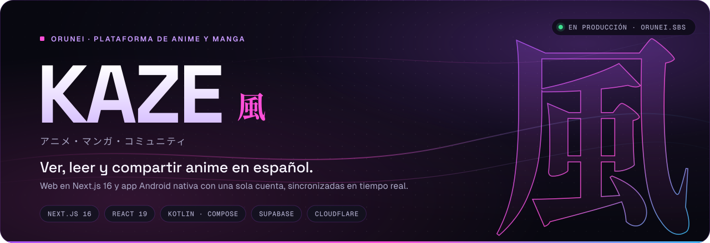
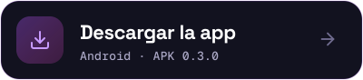
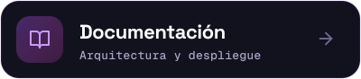
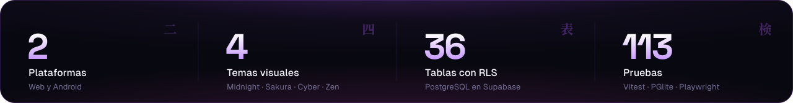
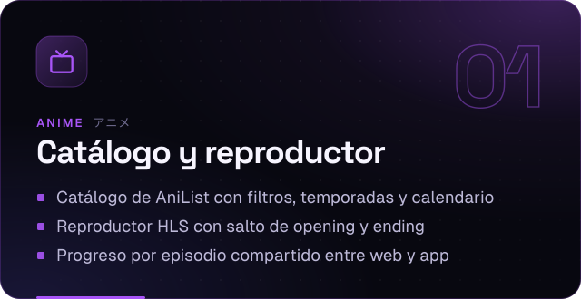
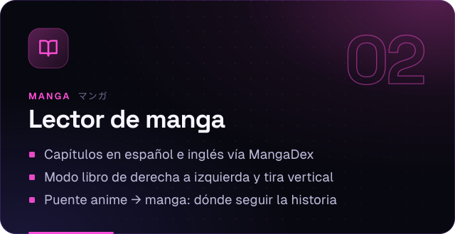
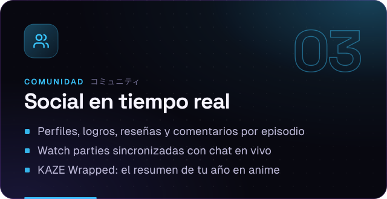
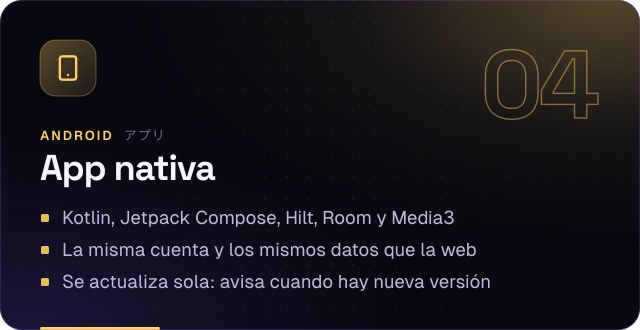
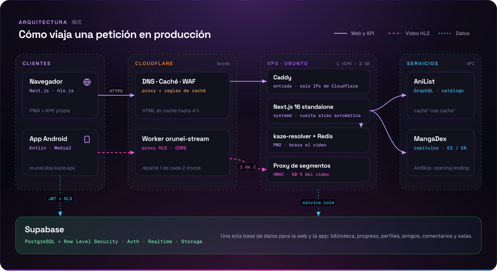
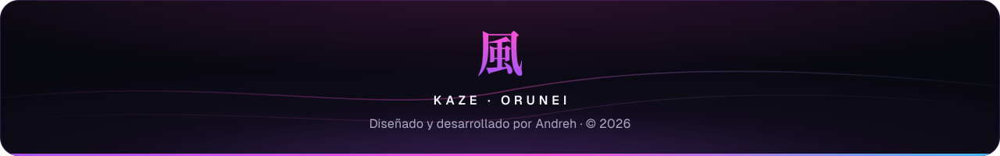

<p align="center">
  
</p>

<p align="center">
  <a href="https://www.orunei.sbs"></a>
  <a href="https://www.orunei.sbs/kaze.apk"></a>
  <a href="docs/ARCHITECTURE.md"></a>
</p>

<p align="center">
  
</p>

## Descripción <sub>概要</sub>

**KAZE** es una plataforma hispanohablante para descubrir, ver y seguir anime y manga, publicada en **[orunei.sbs](https://www.orunei.sbs)**. Se compone de una aplicación web en **Next.js 16** y una aplicación **Android nativa** en Kotlin que comparten una misma cuenta y una misma base de datos en **Supabase**: la biblioteca, el progreso de cada episodio, los comentarios, la actividad social y las salas de visionado se mantienen sincronizados entre dispositivos.

El catálogo y los metadatos provienen de la API pública de **AniList**, y la lectura de manga, de **MangaDex**. KAZE no aloja archivos de vídeo ni de manga: actúa como cliente e indexador de fuentes externas.

## Características <sub>特徴</sub>

<p align="center">
  
  
</p>
<p align="center">
  
  
</p>

<details>
<summary><b>Detalle de funciones</b></summary>

#### Anime
- **Catálogo** con búsqueda, filtros combinables (género, temporada, año, formato, estado), temporadas y calendario semanal de emisión con hora local.
- **Fichas** con personajes, staff, relaciones, tráiler, reseñas y discusiones.
- **Reproductor HLS** (hls.js) con varios servidores, audio original o doblaje latino cuando existe, subtítulos estilizables, salto de opening y ending (AniSkip) y pantalla completa estable entre episodios.
- **Continuar viendo** agrupado por anime: reanuda el episodio a medias o propone el siguiente.
- **Recomendaciones explicables**: combinan los géneros de la biblioteca y del historial real, las recomendaciones de la comunidad de AniList y las secuelas pendientes; cada sugerencia indica su motivo.
- **Avisos de nuevos episodios** de las series que sigue el usuario, con publicación opcional en Discord.

#### Manga
- Capítulos en español latino, español e inglés a través de MangaDex, con reintentos y caché.
- Lector en modo libro (derecha a izquierda) y en tira vertical para webtoons, con zoom y modo de ahorro de datos.
- **Puente anime → manga**: indica en qué capítulo continuar la historia tras terminar el anime.
- Para obras con licencia sin capítulos disponibles, la ficha enlaza a las plataformas oficiales registradas en AniList.

#### Comunidad
- Perfiles personalizables (estilo, vitrina, listas, privacidad por secciones) y logros.
- Amigos, bloqueos, reseñas con puntuación, discusiones y comentarios por episodio, con reportes y moderación.
- **Watch parties**: reproducción sincronizada por el anfitrión con corrección de deriva, presencia y chat en vivo.
- **KAZE Wrapped**: resumen anual de lo visto, con tarjeta para compartir.

#### Cuenta
- Registro por correo con Supabase Auth; los datos del modo invitado se pueden importar al crear la cuenta.
- Vinculación con AniList mediante OAuth 2.0; el token se guarda cifrado con AES-256-GCM y nunca llega al navegador.
- Cuatro temas visuales completos (Midnight, Sakura, Cyber y Zen) con tipografía, color y movimiento propios.

</details>

## Arquitectura <sub>構成</sub>

<p align="center">
  
</p>

- **Cloudflare** es la única puerta de entrada: DNS, caché de páginas, firewall y el Worker `orunei-stream`, que actúa como proxy de los flujos HLS.
- **VPS propia** (Ubuntu): Caddy acepta tráfico únicamente desde los rangos de Cloudflare; la web corre como build *standalone* de Next.js bajo systemd, con despliegue por versiones y vuelta atrás automática si la nueva versión no arranca.
- **Resolución de vídeo**: el servicio `kaze-resolver` (PM2 + Redis) localiza las fuentes; el Worker reparte los segmentos con la VPS, que sirve uno de cada dos mediante enlaces firmados con HMAC, y asume todo el tráfico si la VPS no responde.
- **Supabase** concentra cuentas y datos de usuario con **Row Level Security** en todas las tablas: cada cliente solo accede a lo que sus permisos y la privacidad del perfil permiten.
- **AniList** se consulta desde el servidor con caché de Next.js (`"use cache"`), de modo que el número de peticiones no crece con las visitas.

Más detalle en [`docs/ARCHITECTURE.md`](docs/ARCHITECTURE.md).

## Tecnologías <sub>技術</sub>

| Capa | Tecnologías |
| :--- | :--- |
| **Web** | Next.js 16 (App Router, Cache Components), React 19, TypeScript |
| **Interfaz** | Tailwind CSS v4, Motion, Lucide, tokens de diseño por tema |
| **Estado y datos** | Zustand, TanStack Query, Zod |
| **Vídeo** | hls.js en la web · Media3 / ExoPlayer en Android |
| **Backend** | Supabase: PostgreSQL con RLS, Auth, Realtime y Storage |
| **Android** | Kotlin 2.1, Jetpack Compose, Hilt, Room, DataStore, Media3 |
| **Infraestructura** | VPS Ubuntu, Caddy, systemd, PM2, Redis, Cloudflare (Workers, caché, WAF) |
| **Calidad** | Vitest, Testing Library, PGlite, Playwright, axe, ESLint |
| **Analítica** | Umami (sin cookies de seguimiento) |

## Estructura del repositorio

```text
crunchy/
├── src/
│   ├── app/            # Rutas (App Router): (site), (auth) y api
│   ├── components/     # Interfaz por dominio: home, anime, player, manga, social, profile…
│   ├── lib/            # Lógica: anilist, media, manga, recommend, supabase, seguridad
│   └── stores/         # Estado del cliente (Zustand)
├── mobile/             # App Android (Kotlin + Compose) · ver mobile/README.md
├── supabase/           # Migraciones SQL, políticas RLS y funciones
├── deploy/             # Despliegue en la VPS, Worker de Cloudflare, resolver y APK
├── cache-handlers/     # Gestor de caché propio para "use cache" (memoria acotada)
├── docs/               # Arquitectura, despliegue, mudanza de servidor y manga
└── tests/              # Pruebas unit, db y e2e
```

## Puesta en marcha <sub>導入</sub>

**Requisitos:** Node.js 20 o superior. Supabase es opcional: sin él funcionan el catálogo, el reproductor y la biblioteca local.

```bash
git clone https://github.com/AndrehhX/Kaze.git
cd Kaze
npm install
cp .env.example .env.local   # completar las variables
npm run dev                  # http://localhost:3000
```

| Variable | Uso |
| :--- | :--- |
| `NEXT_PUBLIC_SITE_URL` | URL pública del sitio (OAuth, metadatos y enlaces) |
| `NEXT_PUBLIC_SUPABASE_URL` · `NEXT_PUBLIC_SUPABASE_ANON_KEY` | Conexión a Supabase |
| `SUPABASE_SERVICE_ROLE_KEY` | Clave de servidor para tareas privilegiadas (nunca en el cliente) |
| `NEXT_PUBLIC_ANILIST_CLIENT_ID` · `ANILIST_CLIENT_SECRET` | Aplicación OAuth de AniList |
| `TOKEN_ENCRYPTION_KEY` | Clave AES-256 para cifrar tokens de terceros |
| `STREAM_RESOLVER_URL` · `NEXT_PUBLIC_STREAM_PROXY_URL` | Servicio de resolución y proxy de vídeo |
| `CRON_SECRET` | Protege las tareas programadas |

```bash
npm run dev          # desarrollo
npm run build        # compilación de producción
npm run typecheck    # TypeScript estricto
npm run lint         # ESLint
npm test             # Vitest (unitarias y base de datos)
npm run test:e2e     # Playwright
```

## Despliegue <sub>デプロイ</sub>

| Componente | Cómo se publica |
| :--- | :--- |
| **Web** | `deploy\deploy-vps.ps1` compila en local, sube el build *standalone* y activa la versión; si no arranca, vuelve sola a la anterior |
| **App Android** | `deploy\publish-apk.ps1 -Build` publica la APK y `app-version.json`; la app avisa al usuario de la nueva versión |
| **Worker de vídeo** | `wrangler deploy` desde `deploy/cloudflare-worker/` |

Guías: [`docs/DEPLOY_VPS.md`](docs/DEPLOY_VPS.md) y [`docs/GUIA_MUDANZA_VPS.md`](docs/GUIA_MUDANZA_VPS.md).

## Calidad y seguridad <sub>品質</sub>

- **113 pruebas automáticas**: lógica (recomendaciones, sincronización, filtros, subtítulos, watch parties, manga) y políticas RLS ejecutadas sobre la migración real en PostgreSQL embebido (PGlite); pruebas de extremo a extremo y de accesibilidad con Playwright y axe.
- **Row Level Security** en todas las tablas y funciones `SECURITY DEFINER` para las operaciones sensibles (control de salas, privacidad, bloqueos).
- **Secretos fuera del cliente**: los tokens de AniList se cifran con AES-256-GCM; la clave de servicio solo existe en el servidor.
- **Servidor endurecido**: firewall que solo admite a Cloudflare, SSH exclusivamente con llave, límites de memoria y reinicio automático si la web deja de responder.
- **Entradas validadas** con Zod y restricciones `CHECK` en la base de datos; límites de peticiones por IP en las rutas sensibles; cabeceras de seguridad (CSP, HSTS, `X-Frame-Options`).

## Documentación

| Documento | Contenido |
| :--- | :--- |
| [`docs/ARCHITECTURE.md`](docs/ARCHITECTURE.md) | Capas, caché, persistencia, reproducción, watch parties y recomendaciones |
| [`docs/DEPLOY_VPS.md`](docs/DEPLOY_VPS.md) | Montaje del servidor y operación diaria |
| [`docs/GUIA_MUDANZA_VPS.md`](docs/GUIA_MUDANZA_VPS.md) | Migración completa a otro servidor |
| [`docs/MANGA.md`](docs/MANGA.md) | Lector, proveedores y continuidad anime → manga |
| [`mobile/README.md`](mobile/README.md) | Compilación y estructura de la app Android |
| [`AGENTS.md`](AGENTS.md) | Normas y mapa del proyecto para asistentes de programación |

## Licencia y autoría

**© 2026 Andreh ([@AndrehhX](https://github.com/AndrehhX)). Todos los derechos reservados.**

El código se publica como portafolio y muestra de ingeniería. No se autoriza su redistribución, uso comercial ni el uso de la marca KAZE sin permiso escrito del autor. Consulta [`LICENSE`](LICENSE).

Los metadatos e imágenes de las obras pertenecen a sus titulares y se obtienen de AniList y MangaDex. KAZE no aloja contenido protegido por derechos de autor.

<p align="center">
  
</p>
