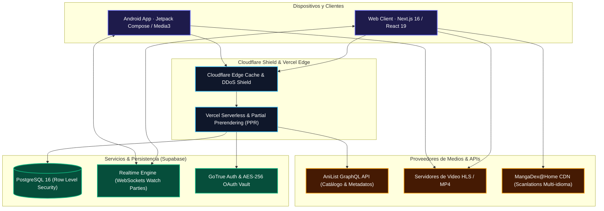

<div align="center">

# KAZE · 風
### *The Next-Generation Anime & Manga Discovery Platform*

[](https://www.orunei.sbs)
[](https://www.orunei.sbs)
[](https://www.orunei.sbs)
[](https://nextjs.org/)

<p align="center">
  <a href="https://www.orunei.sbs"><b>Explorar Plataforma en Vivo</b></a> •
  <a href="https://www.orunei.sbs/manga"><b>Lector de Manga</b></a> •
  <a href="https://www.orunei.sbs/watch-parties"><b>Watch Parties</b></a> •
  <a href="#-características-principales"><b>Características</b></a> •
  <a href="#-arquitectura-técnica"><b>Arquitectura</b></a>
</p>

---

</div>

> [!NOTE]
> **KAZE (Orunei)** es una plataforma de streaming y lectura multimedia diseñada para ofrecer una experiencia limpia, instantánea y de alto rendimiento. Integra streaming adaptativo en alta fidelidad, un lector de manga inmersivo con paso de página físico y tiras continuas de webtoon, sincronización bidireccional con AniList y salas de reproducción sincronizadas en tiempo real.

---

## ✨ Características Principales

<table>
<tr>
<td width="50%" valign="top">

### 🎬 Streaming de Anime de Alta Fidelidad
* **Multi-servidor inteligente:** Selección de proveedores con conmutación por error en milisegundos.
* **Audio y subtítulos:** Español latino, castellano y japonés con subtítulos estilizados.
* **Salto inteligente con AniSkip:** Omite openings y endings con un solo clic o de forma automática.
* **Mini-reproductor Flotante:** Picture-in-Picture nativo que persiste al navegar por el catálogo.

</td>
<td width="50%" valign="top">

### 📖 Lector de Manga 2.0
* **Paso de página físico en 3D:** Animaciones realistas inspiradas en libros impresos y lectura horizontal manga (RTL / LTR).
* **Cascada infinita para Webtoons:** Detección de tiras verticales con ancho optimizado para pantallas panorámicas y móviles.
* **Fallback automático de imágenes:** Redirección transparente a servidores de alta velocidad ante fallos de red o nodos CDN.
* **Múltiples idiomas:** Catálogos comunitarios con traducción en español e inglés.

</td>
</tr>
<tr>
<td width="50%" valign="top">

### 🔗 Continuidad Anime → Manga
* **Cálculo de continuación canónico:** Algoritmo de mapeo que calcula el capítulo exacto del manga donde termina cada temporada de anime.
* **Transición en 1 clic:** Acceso directo desde la ficha del anime hacia el inicio exacto de la historia no adaptada en el manga.

</td>
<td width="50%" valign="top">

### 🍿 Watch Parties en Tiempo Real
* **Salas sincronizadas por WebSockets:** Mira episodios con amigos con compensación de latencia y drift.
* **Chat interactivo en vivo:** Reacciones y presencia en tiempo real potenciadas por Supabase Realtime.

</td>
</tr>
<tr>
<td width="50%" valign="top">

### 🔄 Sincronización con AniList
* **Sincronización bidireccional:** Guarda progreso de episodios vistos y capítulos leídos directamente en tu cuenta de AniList.
* **Seguridad de tokens:** Credenciales OAuth cifradas en reposo con AES-256-GCM.

</td>
<td width="50%" valign="top">

### 📱 Experiencia Multiplataforma
* **Web Progresiva (PWA):** Renderizado híbrido ultra-rápido en Next.js 16 con Partial Prerendering (PPR).
* **Aplicación Android Nativa:** Construida con Jetpack Compose y decodificación por hardware con AndroidX Media3 (ExoPlayer).

</td>
</tr>
</table>

---

## 🏛 Arquitectura Técnica



---

## 🛠 Stack Tecnológico

| Capa | Tecnología | Propósito |
| :--- | :--- | :--- |
| **Framework Web** | `Next.js 16.4` | App Router, Server Actions, Partial Prerendering (PPR) |
| **Librería de UI** | `React 19.3` | Arquitectura de componentes, Concurrent Features |
| **Estilos & Diseño** | `Tailwind CSS v4` | Sistema de diseño Midnight Neon, tokens y microinteracciones |
| **Animaciones** | `Motion (Framer)` | Físicas de resorte, transiciones fluidas de página y modo libro |
| **Estado Global** | `Zustand 5` | Persistencia offline-first de progreso de lectura y reproducción |
| **Base de Datos** | `Supabase / PostgreSQL` | Row Level Security (RLS), autenticación y almacenamiento |
| **Tiempo Real** | `Supabase Realtime` | Canales bidireccionales WebSocket para Watch Parties |
| **Aplicación Móvil**| `Kotlin + Jetpack Compose` | Aplicación Android nativa con ExoPlayer / Media3 |
| **Borde & Seguridad**| `Cloudflare + Vercel` | Caché perimetral, firewall WAF, compresión y optimización |

---

## 🛡 Seguridad y Rendimiento

> [!TIP]
> **Optimización en el Borde:** Más del 50% del ancho de banda y solicitudes son absorbidas directamente en el Edge de Cloudflare, manteniendo la carga de CPU de la base de datos por debajo del 5% y reduciendo la latencia de carga a milisegundos.

* **Row Level Security (RLS):** Cada fila en PostgreSQL está protegida a nivel de base de datos; los clientes solo pueden leer y escribir datos que les pertenecen.
* **Cifrado de Credenciales:** Los tokens OAuth de integraciones externas se cifran en el servidor con **AES-256-GCM** antes de guardarse.
* **Cero Publicidad / Cero Rastreadores Invasivos:** Sin popups, sin scripts de minería ni redirecciones forzadas a terceros.
* **Aislamiento de Lector:** Todos los capítulos de manga y episodios se leen y visualizan íntegramente dentro de KAZE.

---

## 💻 Desarrollo Local

<details>
<summary><b>Haz clic aquí para ver instrucciones de entorno local</b></summary>

### Requisitos Previos
- Node.js 20+ y npm / pnpm
- Proyecto en Supabase (opcional para auth y watch parties)

### Pasos de Instalación
```bash
# 1. Clonar el repositorio
git clone https://github.com/AndrehhX/Kaze.git
cd Kaze

# 2. Instalar dependencias
npm install

# 3. Configurar variables de entorno
cp .env.example .env.local

# 4. Iniciar servidor de desarrollo
npm run dev
```

El servidor estará disponible en `http://localhost:3000`.

</details>

---

## ⚖️ Licencia y Propiedad Intelectual

> [!IMPORTANT]
> **Derechos de Autor (c) 2026 Andreh (@AndrehhX). Todos los derechos reservados.**
>
> Este repositorio se comparte públicamente como **muestra de ingeniería, portafolio profesional e investigación técnica**. No se autoriza la redistribución comercial, clonación de marca ni explotación lucrativa sin autorización expresa por escrito del autor.
>
> *Los metadatos, pósters e información de obras son obtenidos a través de la API oficial de AniList bajo principios de Fair Use. KAZE no aloja archivos multimedia con derechos en sus servidores, operando únicamente como interfaz y cliente de visualización.*

---

<div align="center">
  <sub>Desarrollado con pasión para la comunidad de Anime & Manga · <b>KAZE / Orunei</b></sub>
</div>
