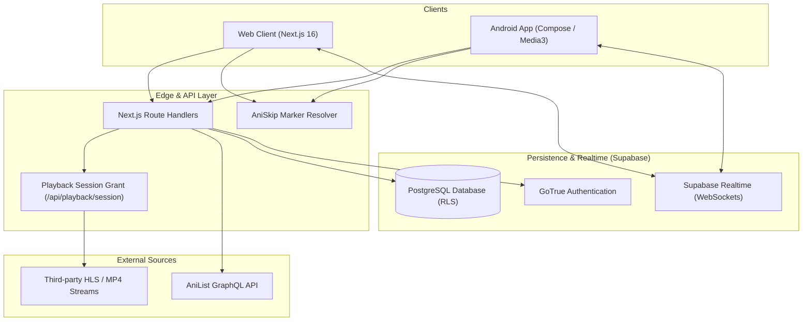

# KAZE

Anime streaming, catalog discovery, and synchronized watch parties across web and Android.

[](https://nextjs.org/)
[](https://react.dev/)
[](https://www.typescriptlang.org/)
[](https://developer.android.com/jetpack/compose)
[](https://developer.android.com/media/media3)
[](https://supabase.com/)
[](https://tailwindcss.com/)
[](LICENSE)

[Live Web App](https://www.orunei.sbs) | [Download Android APK](https://www.orunei.sbs/kaze.apk) | [Architecture](#architecture) | [Features](#features) | [Setup](#setup) | [Legal & License](#legal--license)

---

## Table of Contents
- [Overview](#overview)
- [Architecture](#architecture)
- [Features](#features)
- [Tech Stack](#tech-stack)
- [Security](#security)
- [Setup](#setup)
  - [Web Client](#web-client-nextjs)
  - [Android Client](#android-client-kotlin--compose)
  - [Environment Variables](#environment-variables)
- [Testing & Quality](#testing--quality)
- [Legal & License](#legal--license)

---

## Overview

KAZE (deployed in production as [Orunei](https://www.orunei.sbs)) is a cross-platform anime media and discovery application. It includes a web frontend built with Next.js 16 and React 19, and a native Android app written in Kotlin using Jetpack Compose and AndroidX Media3 (ExoPlayer).

The project is built around four practical requirements:
- Video streaming with HLS/MP4 playback, server fallback, and automated skip points.
- Realtime synchronized watch parties over WebSockets with client-side drift compensation.
- A fast, clean interface without popups or intrusive overlays.
- Offline-first tracking with local persistence and background cloud sync.

---

## Architecture



### Monorepo Layout

```
kaze/
├── src/                         # Next.js web application
│   ├── app/                     # App Router pages and API routes
│   │   ├── api/                 # Playback session grants and AniList OAuth
│   │   ├── anime/[id]/          # Anime details and episode index
│   │   ├── watch/[id]/[ep]/     # Web player interface
│   │   └── party/               # Realtime watch party rooms
│   ├── components/              # UI components
│   ├── lib/                     # Client and server business logic
│   │   ├── anilist/             # GraphQL queries and client cache
│   │   ├── media/               # Stream resolver logic and AniSkip integration
│   │   ├── recommend.ts         # Recommendation scoring
│   │   └── watch-party/         # Drift-correction and sync logic
│   └── stores/                  # Zustand stores for settings and local state
├── mobile/                      # Native Android client
│   ├── app/src/main/java/com/kaze/mobile/
│   │   ├── core/                # Room database, network, and theme tokens
│   │   ├── data/                # Data repositories and remote loaders
│   │   ├── domain/              # Models, playback abstractions, sync planner
│   │   └── feature/             # Compose screens (Home, Player, Library, Party)
│   └── build.gradle.kts         # Android build configuration (minSdk 26, targetSdk 35)
├── supabase/                    # Database migrations and seed files
└── public/                      # Static assets and compiled APK
```

---

## Features

### Playback Engine
- Dynamic session grants (`/api/playback/session`) prevent direct URL scraping and hotlinking.
- Dual-mode streaming supporting adaptive HLS (`Hls.js` on desktop web, AVPlayer on Safari/iOS) and hardware-accelerated Media3 ExoPlayer on Android.
- AniSkip integration to mark and skip intro/outro sequences with a single click.
- Audio and subtitle switching between Japanese original with localized subtitles and Spanish dubs when available.

### Synchronized Watch Rooms
- Host-authoritative playback: play, pause, seek, and episode switches broadcast to all room members.
- Client-side drift correction: measures round-trip time (RTT) over WebSockets and adjusts playback speed (0.95x - 1.05x) for small offsets, or seeks if the difference exceeds 1 second.
- Room presence, participant list, and synchronized chat reactions.

### Android Client
- Native Kotlin implementation with Jetpack Compose and Material 3 design tokens.
- Media3 ExoPlayer integration with Picture-in-Picture (PiP), background audio, and brightness/volume swipe gestures.
- Local SQLite storage through Room DB with KSP code generation and Coil 3 image caching.

### Library & Synchronization
- Local-first architecture: changes write immediately to IndexedDB/LocalStorage (Web) or Room (Android) for instant response.
- Background sync: reconciles watchlist, progress, and ratings with Supabase when online, using a Last-Write-Wins strategy.

---

## Tech Stack

| Component | Technology | Role |
| :--- | :--- | :--- |
| Web Framework | Next.js 16.4 | App Router, Server Actions, edge API endpoints |
| Frontend Library | React 19.3 | Component rendering and client state |
| Type System | TypeScript 5.x | Strict type checking across the web app |
| Web Styling | Tailwind CSS v4 | Utility classes and theme styling |
| Client State | Zustand 5 + TanStack Query 5 | Client store and server-state caching |
| Android Platform | Kotlin 2.0 | Native application logic |
| Android UI | Jetpack Compose | Declarative UI components |
| Android Media | AndroidX Media3 (ExoPlayer) | Hardware decoding, buffering, and PiP lifecycle |
| Database & Auth | Supabase (PostgreSQL 16) | User authentication, RLS tables, and RPC |
| Realtime | Supabase Realtime | WebSocket channels for watch parties |

---

## Security

- PostgreSQL Row Level Security (RLS) is enabled on all tables. Anonymous client requests can only access records scoped to the authenticated user ID.
- AniList OAuth access tokens are encrypted at rest using AES-256-GCM on the server before storage.
- Content Security Policy headers restrict script execution and disable unauthorized framing (`X-Frame-Options: SAMEORIGIN`).
- Stream session tokens are time-limited and validated against expected request headers.

---

## Setup

### Prerequisites
- Node.js 20 or later
- npm or pnpm
- JDK 17 or later (for Android builds)
- Android SDK with API level 35 installed

---

### Web Client (Next.js)

1. Clone the repository:
   ```bash
   git clone https://github.com/AndrehhX/Kaze.git
   cd Kaze
   ```

2. Install dependencies:
   ```bash
   npm install
   ```

3. Create the environment file:
   ```bash
   cp .env.example .env.local
   ```

4. Start the development server:
   ```bash
   npm run dev
   ```
   Open `http://localhost:3000` in your browser.

5. Build for production:
   ```bash
   npm run build
   npm run start
   ```

---

### Android Client (Kotlin / Compose)

1. Open the `mobile` folder:
   ```bash
   cd mobile
   ```

2. Configure `local.properties`:
   ```properties
   sdk.dir=/path/to/android/sdk
   SUPABASE_URL=https://<your-project>.supabase.co
   SUPABASE_ANON_KEY=<your-supabase-anon-key>
   ```

3. Build the debug APK:
   ```bash
   ./gradlew assembleDebug
   ```
   The binary is generated at `mobile/app/build/outputs/apk/debug/app-debug.apk`.

---

### Environment Variables

| Variable | Required | Description |
| :--- | :--- | :--- |
| `NEXT_PUBLIC_SITE_URL` | Yes | Base public domain URL (e.g. `https://www.orunei.sbs`) |
| `NEXT_PUBLIC_SUPABASE_URL` | Optional* | Supabase URL for accounts and cloud sync |
| `NEXT_PUBLIC_SUPABASE_ANON_KEY` | Optional* | Supabase anonymous key for client requests |
| `NEXT_PUBLIC_ANILIST_CLIENT_ID` | Optional | OAuth Client ID for AniList account integration |
| `SUPABASE_SERVICE_ROLE_KEY` | No (Server) | Service role key for admin tasks |
| `ANILIST_CLIENT_SECRET` | Optional (Server) | Secret for server-side OAuth exchange |
| `TOKEN_ENCRYPTION_KEY` | Optional (Server) | 32-byte Base64 key for AES-256-GCM encryption |

*\* Note: The public catalog works without Supabase. Authentication and watch parties require Supabase credentials.*

---

## Testing & Quality

```bash
# Unit and component tests
npm run test

# Type verification
npm run typecheck

# Code linter
npm run lint

# End-to-end tests
npm run test:e2e
```

---

## Legal & License

### Disclaimer
- Metadata, schedules, and cover images are retrieved via the official AniList GraphQL API under fair use principles.
- KAZE does not host, store, or upload media files on its servers. The application functions as an interface and stream resolver pointing to third-party sources.
- For copyright or DMCA notices, contact: `thealex230820@gmail.com`. Notices are reviewed and handled within 48 hours.

### Copyright & Terms of Use
**Copyright (c) 2026 Andreh (@AndrehhX). All rights reserved.**

This source code, designs, and assets are shared publicly for personal portfolio review and educational purposes only.

- You may not clone, rename, or redistribute this repository to present it as your own work.
- You may not sell, license, or host public commercial instances of this application without prior written permission from the author.
- Legitimate contributions, bug reports, and educational research are welcome.

For inquiries: `thealex230820@gmail.com`.
