<p align="center">
  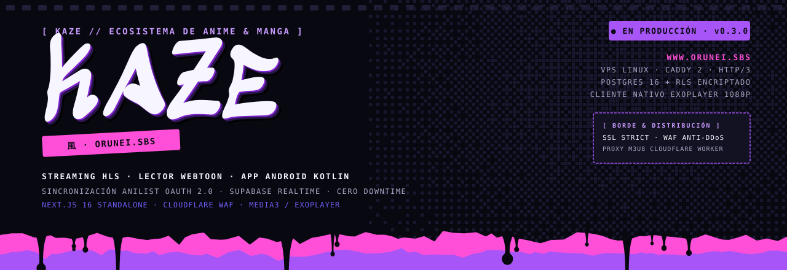
</p>

<p align="center">
  <a href="https://www.orunei.sbs" target="_blank">
    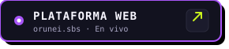
  </a>
  <a href="https://www.orunei.sbs/kaze.apk">
    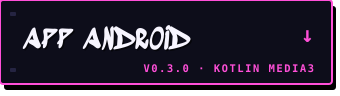
  </a>
  <a href="#cuenta-e-integraciones">
    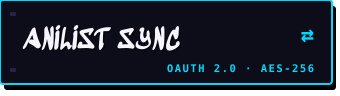
  </a>
</p>

<p align="center">
  
</p>

## Descripción

**KAZE** (dominio **Orunei**) es una plataforma de alto rendimiento para descubrir, ver y seguir anime y manga. Diseñada como un ecosistema híbrido compuesto por una **aplicación web moderna** en Next.js 16 y una **aplicación Android nativa** en Kotlin con Jetpack Compose.

Ambas interfaces comparten una única cuenta centralizada y base de datos reactiva en Supabase: biblioteca de favoritos, progreso en tiempo real de cada episodio, comentarios sincronizados, actividad social y salas de cine (*Watch Parties*) se mantienen al unísono entre dispositivos sin fricción.

El catálogo y metadatos se sincronizan desde la API pública de **AniList**. La plataforma no aloja contenido multimedia propio: opera como cliente de visualización e indexador distribuido de alta velocidad.

<p align="center">
  
</p>

<p align="center">
  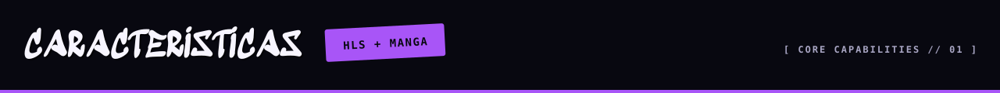
</p>

<p align="center">
  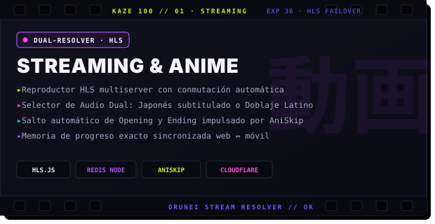
  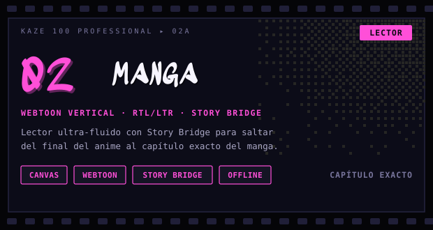
</p>

<p align="center">
  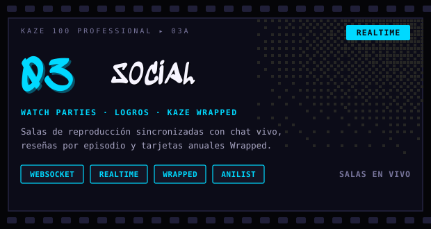
  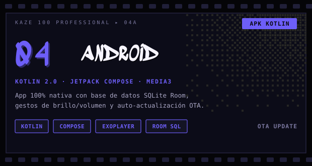
</p>

### Desglose Funcional

#### Anime
- **Catálogo inteligente:** Búsqueda instantánea con filtros combinados por género, temporada, año, formato y estado de emisión, con fichas detalladas (reparto de personajes, tráiler en alta definición y árbol de relaciones).
- **Reproductor HLS adaptativo:** Multi-servidor con conmutación por error (*auto-failover*) imperceptible, selector de audio dual (Japonés original subtitulado o Doblaje Latino) y omisión inteligente de Opening/Ending mediante integración con AniSkip.
- **Continuar viendo:** Progreso exacto por segundo almacenado en Supabase y retomable al instante desde la web o el móvil.
- **Calendario y notificaciones:** Agenda semanal de emisiones y alertas push programadas para nuevos episodios en emisión.

#### Manga
- **Lector de alto rendimiento:** Modos de lectura configurables: doble página (RTL japonés tradicional o LTR occidental) y tira vertical continua con scroll suave optimizado para Webtoons y Manhwas.
- **Anime-to-Manga Story Bridge:** Algoritmo de mapeo que calcula con exactitud el capítulo del manga correspondiente al episodio final de cada temporada para continuar la historia de inmediato.
- **Biblioteca local:** Marcadores, historial de lectura y caché local para lectura rápida sin cuellos de botella.

#### Comunidad & Social
- **Perfiles personalizables:** Nivel de usuario, vitrina de insignias y logros desbloqueables, personalización de paleta y temas visuales.
- **Actividad social:** Sistema de seguimiento de amigos, reseñas comunitarias con puntuación, hilos de debate y comentarios anclados por episodio.
- **Watch Parties en tiempo real:** Salas de reproducción sincronizada con presencia activa, chat en vivo y algoritmo de compensación de latencia entre espectadores.
- **KAZE Wrapped anual:** Recapitulación interactiva con estadísticas anuales de minutos reproducidos y géneros favoritos, con tarjeta gráfica para compartir.

#### Cuenta e Integraciones
- **AniList OAuth 2.0:** Sincronización bidireccional de listas. Los tokens de autenticación se almacenan cifrados en base de datos con AES-256-GCM.
- **Autenticación segura:** Registro por email mediante Supabase Auth con confirmación y control de sesiones activas.

<p align="center">
  
</p>

<p align="center">
  
</p>

<p align="center">
  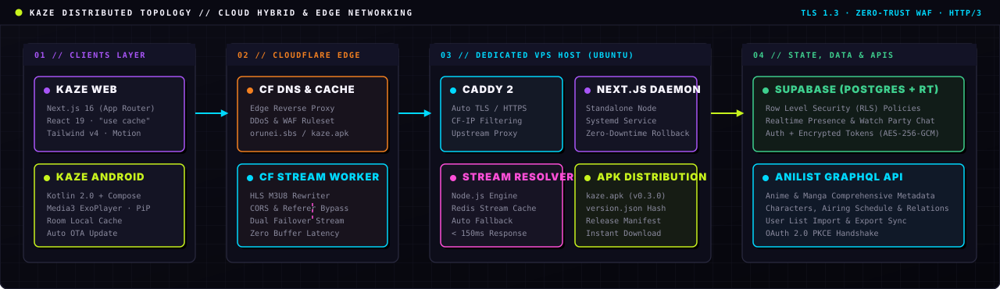
</p>

### Principios de la Arquitectura

1. **Borde Cloudflare:** Frente unificado para DNS, proxy inverso con SSL estricto, compresión Brotli y firewall perimetral (WAF). La VPS rechaza cualquier petición cuyo origen no pertenezca a los rangos de IP certificados de Cloudflare.
2. **Web Standalone en VPS:** Next.js compilado en modo *standalone* administrado por `systemd`, garantizando consumo acotado de RAM y despliegues con cero tiempo de inactividad (*zero-downtime*) y reversión automática ante fallos.
3. **Persistencia y Seguridad Supabase:** Base de datos PostgreSQL blindada con **Row Level Security (RLS)** a nivel de fila: ningún usuario ni cliente no autenticado puede consultar datos fuera de su propio alcance.
4. **Proxy de Video Cloudflare Worker:** Procesador de manifiestos M3U8 en el borde que elimina bloqueos CORS y referrers restrictivos de los proveedores de video.
5. **App Android Desacoplada:** La app nativa interactúa de forma directa con Supabase y AniList GraphQL, consumiendo la API web únicamente para la resolución dinámica de streams HLS.

<p align="center">
  
</p>

<p align="center">
  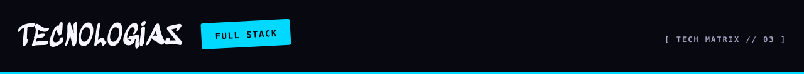
</p>

<p align="center">
  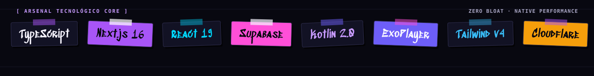
</p>

| Capa | Tecnologías | Propósito |
| :--- | :--- | :--- |
| **Frontend Web** | Next.js 16 (App Router, `use cache`), React 19, TypeScript | Renderizado híbrido ultrarrápido y Server Actions |
| **Estilos & UI** | Tailwind CSS v4, Motion, Lucide Icons | Sistema de tokens de diseño Midnight Neon y animaciones |
| **Estado & Caché** | Zustand, TanStack Query v5, Zod | Reactividad client-side y validación estricta de esquemas |
| **Reproducción de Video** | hls.js (Web), Media3 / ExoPlayer (Android) | Streaming adaptativo HLS con buffer dinámico y PiP |
| **Backend & Base de Datos** | Supabase: PostgreSQL con RLS, Auth, Realtime | Autenticación, persistencia atómica y canales WebSocket |
| **App Android Nativa** | Kotlin 2.0, Jetpack Compose, Room, Hilt, Coil | Cliente móvil con base de datos local y sincronización |
| **Infraestructura & Edge** | VPS Ubuntu, Caddy 2, systemd, Cloudflare Workers | Servidor web HTTP/3, proxy de streams y caché de borde |
| **Testing & Calidad** | Vitest, Testing Library, PGlite, Playwright + axe | Pruebas unitarias, de integración, E2E y accesibilidad |

<p align="center">
  
</p>

<p align="center">
  
</p>

La aplicación Android de **KAZE** está construida desde cero sin wrappers web ni WebView:
- **Motor Media3 / ExoPlayer:** Soporte completo para Picture-in-Picture nativo, controles táctiles gestuales para brillo y volumen, y decodificación de video por hardware.
- **Offline-First con Room:** Toda la biblioteca personal se persiste en una base de datos SQLite interna gestionada por Room, sincronizándose en segundo plano al recuperar la conexión.
- **Actualización OTA Integrada:** Comprueba automáticamente al iniciar si existe una versión superior en el servidor de distribución y permite actualizar la APK con un solo toque.

```bash
# Compilar la APK de producción
cd mobile
./gradlew assembleRelease
```
> Consulta la guía técnica completa en [`mobile/README.md`](mobile/README.md).

<p align="center">
  
</p>

<p align="center">
  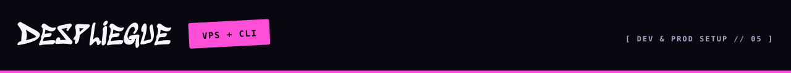
</p>

### Instalación Local

**Requisitos:** Node.js 20+ y npm. Opcional: Proyecto en Supabase para funciones sociales (sin él funcionan catálogo, reproductor y biblioteca local).

```bash
git clone https://github.com/AndrehhX/Kaze.git
cd Kaze
npm install
cp .env.example .env.local   # Completa las variables
npm run dev                  # http://localhost:3000
```

#### Variables de Entorno Clave

| Variable | Descripción |
| :--- | :--- |
| `NEXT_PUBLIC_SITE_URL` | URL canónica del sitio (redirecciones OAuth y metadata OpenGraph) |
| `NEXT_PUBLIC_SUPABASE_URL` · `ANON_KEY` | Credenciales de conexión a Supabase |
| `SUPABASE_SERVICE_ROLE_KEY` | Clave de administración (solo servidor) para tareas privilegiadas |
| `NEXT_PUBLIC_ANILIST_CLIENT_ID` · `SECRET` | Credenciales de la aplicación OAuth en AniList |
| `TOKEN_ENCRYPTION_KEY` | Clave maestra AES-256 (32 bytes en base64) para cifrar tokens |

#### Scripts de Desarrollo & Control de Calidad

```bash
npm run dev           # Servidor local de desarrollo
npm run build         # Compilación de producción
npm start             # Iniciar bundle de producción
npm run typecheck     # Verificación estricta de TypeScript
npm run lint          # Análisis estático ESLint
npm test              # Suite de pruebas unitarias con Vitest
npm run test:e2e      # Pruebas end-to-end con Playwright
```

### Despliegue en Producción

- **Web (VPS):** Compila en local y transfiere el artefacto *standalone*. Si la nueva versión no responde al test de salud, revierte automáticamente a la versión anterior:
  ```powershell
  powershell -ExecutionPolicy Bypass -File deploy\deploy-vps.ps1
  ```
- **Android APK:** Publicación con incremento automático de `versionCode`:
  ```powershell
  powershell -ExecutionPolicy Bypass -File deploy\publish-apk.ps1 -Build -Notes "Nuevas mejoras"
  ```
- Guías de infraestructura: [`docs/DEPLOY_VPS.md`](docs/DEPLOY_VPS.md) y [`docs/GUIA_MUDANZA_VPS.md`](docs/GUIA_MUDANZA_VPS.md).

<p align="center">
  
</p>

## Seguridad & Buenas Prácticas

- **Row Level Security (RLS):** Aislamiento de tenants garantizado en PostgreSQL por políticas RLS.
- **Criptografía AES-256-GCM:** Cifrado simétrico de credenciales y tokens OAuth externos.
- **Defensa en Profundidad:** VPS con firewall UFW estricto, SSH con clave ed25519 y puertos expuestos exclusivamente al rango de Cloudflare.
- **Rate Limiting:** Control de concurrencia y peticiones por IP real (`cf-connecting-ip`) en endpoints sensibles.
- **Sin Publicidad ni Rastreo:** Experiencia limpia, sin minería de datos ni telemetría invasiva.

<p align="center">
  
</p>

<p align="center">
  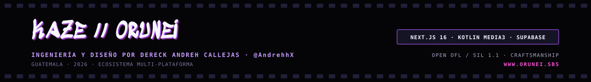
</p>
