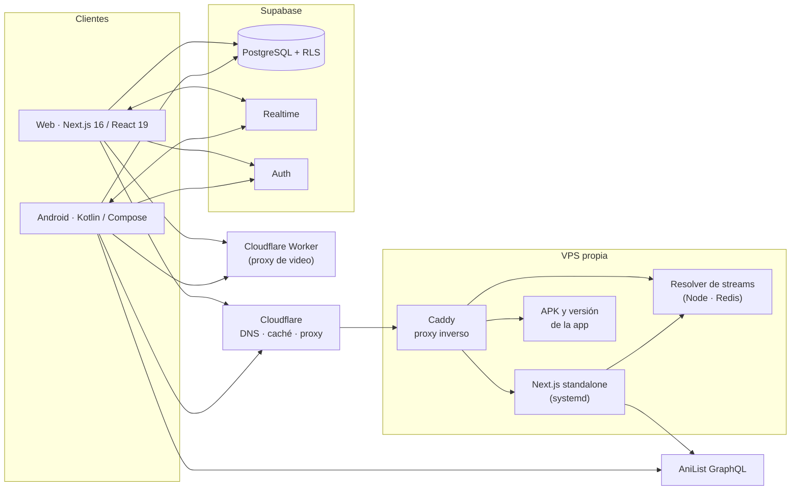

<div align="center">

# KAZE · 風

**Plataforma de anime y manga: catálogo, streaming, lector, comunidad y app Android, con una sola cuenta.**

[](https://www.orunei.sbs)
[](https://www.orunei.sbs/kaze.apk)
[](https://nextjs.org/)
[](https://supabase.com/)

[Plataforma en vivo](https://www.orunei.sbs) · [Descargar la app](https://www.orunei.sbs/kaze.apk) · [Características](#características) · [Arquitectura](#arquitectura) · [Instalación](#instalación-local) · [Despliegue](#despliegue)

</div>

---

## Descripción

**KAZE** (dominio **Orunei**) es una plataforma para descubrir, ver y seguir anime y manga. Está formada por una **aplicación web** en Next.js y una **aplicación Android nativa** en Kotlin. Las dos comparten la misma cuenta y la misma base de datos en Supabase, así que la biblioteca, el progreso de cada episodio, los comentarios, los amigos y las salas de cine se sincronizan entre web y móvil.

El catálogo y los metadatos vienen de la API pública de **AniList**. La plataforma no aloja contenido multimedia propio: funciona como interfaz y cliente de visualización.

## Características

### Anime
- **Catálogo completo** con búsqueda, filtros por género, temporada y formato, y fichas detalladas (personajes, relaciones, recomendaciones y tráiler).
- **Reproductor HLS** con varios servidores y cambio automático si uno falla, audio japonés subtitulado o doblaje latino, y salto de opening y ending con AniSkip.
- **Continuar viendo**: el progreso se guarda por episodio y se retoma en cualquier dispositivo.
- **Calendario de emisión** semanal y **avisos de episodios nuevos** de las series que sigues (en la web y, opcionalmente, en Discord).

### Manga
- **Lector** con modo página (RTL o LTR) y tira vertical continua para webtoons.
- **Del anime al manga**: calcula el capítulo exacto donde termina cada temporada para seguir la historia.
- Biblioteca, colecciones y estadísticas de lectura.

### Comunidad
- **Perfiles personalizables** con vitrinas, nivel, logros y color propio.
- **Amigos**, actividad de amigos, reseñas con nota, debates y **comentarios por episodio**.
- **Watch parties**: salas sincronizadas en tiempo real con chat, reacciones y presencia, compensando la latencia entre participantes.
- **Wrapped**: resumen anual de lo que has visto, con una tarjeta para compartir.

### Cuenta e integraciones
- Registro con email y confirmación por correo.
- **Sincronización con AniList** (OAuth): importa y exporta tu lista. Los tokens se guardan cifrados con AES-256-GCM.
- Temas visuales y ajustes de privacidad (perfil, actividad y presencia).

### App Android
- Nativa: **Kotlin + Jetpack Compose**, reproductor **Media3/ExoPlayer**, Picture-in-Picture y descargas.
- **Funciona sin conexión**: biblioteca local en Room que se sincroniza sola con la web.
- **Aviso de actualización** integrado: la app detecta cuándo hay una versión nueva publicada en la web.

## Arquitectura



- **Cloudflare** está delante de todo: DNS, caché de borde y protección. El firewall de la VPS solo acepta tráfico desde los rangos de Cloudflare.
- **La web** corre como build *standalone* de Next.js bajo systemd, con despliegues versionados y vuelta atrás automática si una versión no arranca.
- **Supabase** guarda las cuentas, los datos de cada usuario (protegidos con Row Level Security) y los canales en tiempo real de las watch parties.
- **La app Android** habla directamente con Supabase y AniList, y usa la web para resolver la reproducción.

## Stack

| Capa | Tecnología |
| --- | --- |
| Web | Next.js 16 (App Router, `use cache`), React 19, TypeScript |
| Estilos y animación | Tailwind CSS v4, Motion |
| Estado y datos | Zustand, TanStack Query, Zod |
| Video | hls.js (web), Media3/ExoPlayer (Android) |
| Backend | Supabase: PostgreSQL con RLS, Auth y Realtime |
| Android | Kotlin, Jetpack Compose, Hilt, Room, Coil, OkHttp |
| Infraestructura | VPS Ubuntu, Caddy, systemd, Cloudflare (DNS, caché, Worker) |
| Pruebas | Vitest, Testing Library, PGlite (base de datos), Playwright con axe (E2E y accesibilidad) |

## Estructura del repositorio

```
crunchy/
├── src/
│   ├── app/              # Rutas (App Router): (site), (auth), api, sitemap, robots
│   ├── components/       # UI por dominio: anime, player, manga, social, profile, shell…
│   ├── lib/              # Lógica: anilist, supabase, streaming, logros, wrapped, seguridad
│   ├── stores/           # Estado global (Zustand)
│   └── types/
├── mobile/               # App Android (Kotlin + Compose), ver mobile/README.md
├── supabase/migrations/  # Esquema SQL, políticas RLS y funciones
├── deploy/               # Scripts de despliegue en VPS y publicación de la APK
├── cache-handlers/       # Gestor de caché propio para "use cache" (memoria acotada)
├── docs/                 # Arquitectura, despliegue, mudanza de VPS y manga
├── tests/                # unit, db y e2e
└── scripts/              # Pruebas de humo (crawl / interact)
```

## Instalación local

**Requisitos:** Node.js 20 o superior y npm. Opcional: un proyecto de Supabase para cuentas y funciones sociales (sin él funcionan el catálogo, el reproductor y la biblioteca local).

```bash
git clone https://github.com/AndrehhX/Kaze.git
cd Kaze
npm install
cp .env.example .env.local   # completa las variables
npm run dev                  # http://localhost:3000
```

### Variables de entorno

| Variable | Uso |
| --- | --- |
| `NEXT_PUBLIC_SITE_URL` | URL pública del sitio (redirecciones OAuth y metadatos) |
| `NEXT_PUBLIC_SUPABASE_URL` · `NEXT_PUBLIC_SUPABASE_ANON_KEY` | Conexión a Supabase |
| `SUPABASE_SERVICE_ROLE_KEY` | Solo servidor: tokens de AniList y borrado de cuentas |
| `NEXT_PUBLIC_ANILIST_CLIENT_ID` · `ANILIST_CLIENT_SECRET` | OAuth de AniList |
| `TOKEN_ENCRYPTION_KEY` | Clave AES-256 (32 bytes en base64) para cifrar tokens |

### Scripts

| Comando | Descripción |
| --- | --- |
| `npm run dev` | Servidor de desarrollo |
| `npm run build` · `npm start` | Build de producción y arranque |
| `npm run lint` · `npm run typecheck` | ESLint y comprobación de tipos |
| `npm test` | Pruebas unitarias y de base de datos (Vitest) |
| `npm run test:e2e` | Pruebas end-to-end y de accesibilidad (Playwright) |

### App Android

Requiere JDK 17 y Android SDK 35. Los detalles están en [`mobile/README.md`](mobile/README.md).

```bash
cd mobile
./gradlew assembleRelease
```

## Despliegue

**Web (VPS).** Se compila en local y se sube un paquete *standalone*. El script activa la versión nueva y vuelve sola a la anterior si no responde:

```powershell
powershell -ExecutionPolicy Bypass -File deploy\deploy-vps.ps1
```

**App Android.** Sube `versionCode` en `mobile/app/build.gradle.kts` y publica. Las apps instaladas mostrarán el aviso de nueva versión:

```powershell
powershell -ExecutionPolicy Bypass -File deploy\publish-apk.ps1 -Build -Notes "Qué cambió"
```

Guías completas en [`docs/DEPLOY_VPS.md`](docs/DEPLOY_VPS.md) y, para cambiar de servidor, [`docs/GUIA_MUDANZA_VPS.md`](docs/GUIA_MUDANZA_VPS.md).

## Seguridad

- **Row Level Security** en todas las tablas: cada usuario solo puede leer y escribir lo que le corresponde.
- **Tokens de terceros cifrados** (AES-256-GCM) y claves de servicio solo en el servidor.
- **Origen protegido:** la VPS solo acepta tráfico de Cloudflare, SSH únicamente con llave y panel de administración con contraseña.
- **Límite de peticiones** por IP real (`cf-connecting-ip`) en las rutas sensibles.
- Sin anuncios intrusivos, sin rastreadores de terceros y sin redirecciones forzadas.

## Mantenimiento

- **Monitorización:** la VPS comprueba cada 2 minutos que la web responde y reinicia el servicio si no lo hace.
- **Avisos de episodios:** una tarea programada cada 30 minutos genera las notificaciones de estrenos.
- **Firewall:** los rangos de Cloudflare se actualizan solos cada semana.
- **Calidad:** ejecuta `npm run lint`, `npm run typecheck` y `npm test` antes de cada despliegue.
- **Documentación:** las decisiones de arquitectura y las operaciones están en [`docs/`](docs/).

## Licencia y autoría

**© 2026 Andreh ([@AndrehhX](https://github.com/AndrehhX)). Todos los derechos reservados.**

Este repositorio es público como muestra de ingeniería y portafolio profesional. No se autoriza su redistribución, uso comercial ni la reutilización de la marca sin permiso escrito del autor. Consulta [`LICENSE`](LICENSE).

Los metadatos e imágenes de las obras provienen de la API de AniList. KAZE no aloja archivos multimedia protegidos por derechos de autor.

<div align="center"><sub>KAZE · Orunei: desarrollado por Andreh</sub></div>
